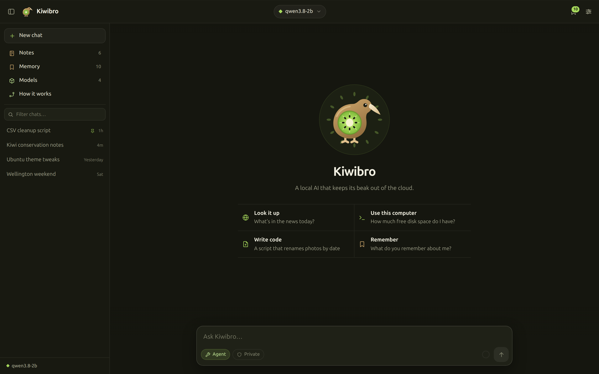
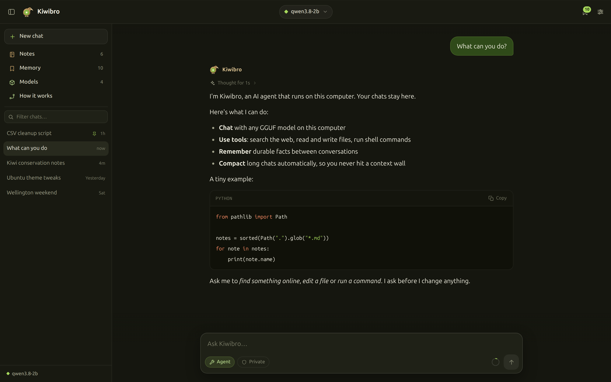
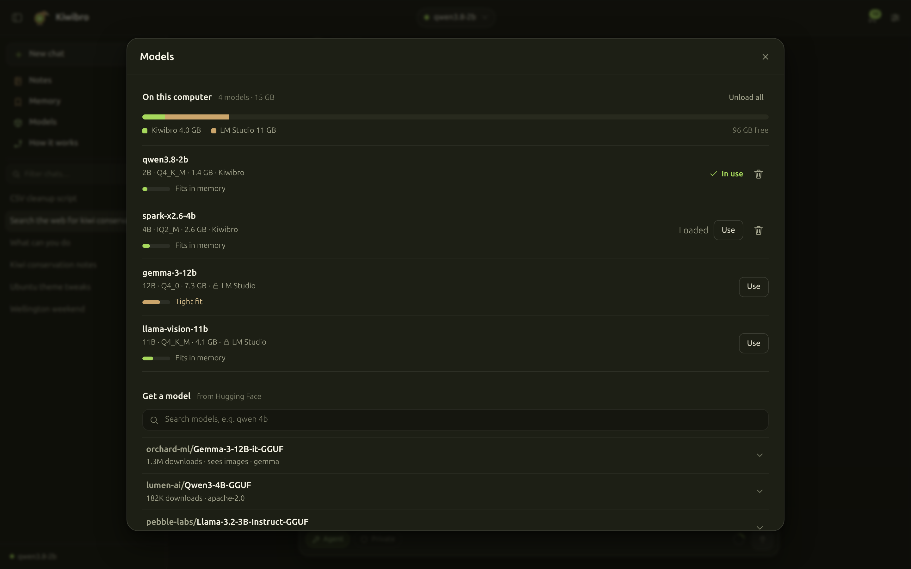
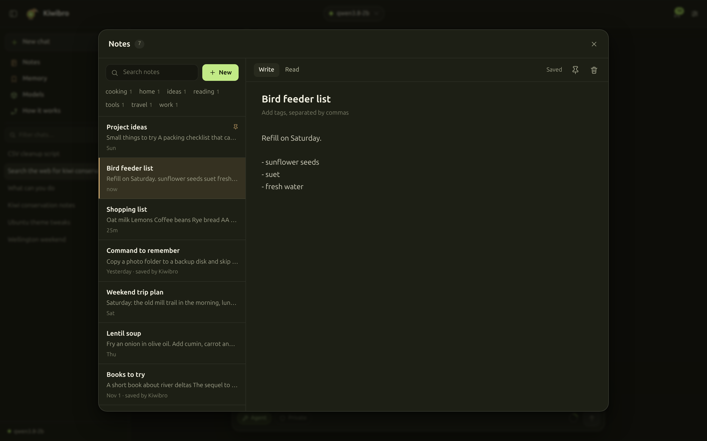
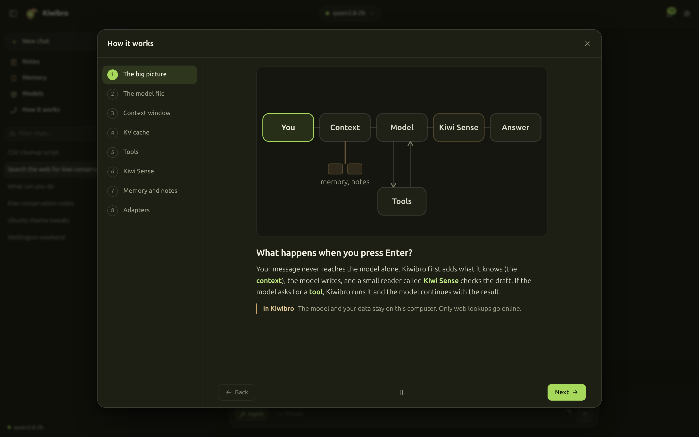

<div align="center">



# Kiwibro

**A local AI agent for Linux that makes small models useful.**

[](https://github.com/yunusemrejr/kiwibro/actions/workflows/ci.yml)
[](LICENSE)
[](https://www.python.org)

`Flask` · `llama.cpp` · `Browser GUI with a native Ubuntu soul` · `No cloud`

</div>

---

Kiwibro runs open models on your own computer and gives them what a small model lacks:
a steady character, a memory, a notebook, tools that work even when the model fumbles
the call, and a second, tiny model that reads every reply and steps in when it goes
wrong. It runs the models itself with [llama.cpp](https://github.com/ggml-org/llama.cpp);
no other app is needed.

- **Any model, same Kiwibro.** Download a model from Hugging Face inside the app, or use
  the ones LM Studio already downloaded. Swap mid-chat; memories, notes and transcripts
  stay.
- **Kiwi Sense.** A 2.7 MB reading model (WebAssembly) watches each reply as it streams.
  A model that claims to be another assistant, says it cannot search when it can, or
  announces work it never did is stopped after that sentence and put right.
- **Memory and notes.** Facts about you are learned in the background and found again by
  words or by meaning. Kiwibro keeps a notebook it can write to and read from, and so
  can you.
- **Long chats stay sharp.** Older turns are summarised, the exact words of an earlier
  exchange come back when you ask about it, and the model never re-reads what it has
  already read.
- **Tools that survive small models.** 46 tools; broken or misspelled calls are repaired,
  calls written as plain text are recovered, and a follow-up search like "how old is he?"
  is completed with the name it points at.
- **Light.** One Python process of under 80 MB. The model leaves memory after 30 idle
  minutes. On a laptop with integrated graphics the model runs on the GPU.
- **Local.** SQLite on disk, loopback server, no telemetry, no accounts.

<br>

<div align="center">


<br>


</div>

## Quick start

```bash
git clone https://github.com/yunusemrejr/kiwibro.git
cd kiwibro
./scripts/run.sh        # installs Flask, requests and beautifulsoup4 into a local .venv
```

Open **<http://127.0.0.1:8777>**. On first start Kiwibro shows two steps:

1. **Install engine.** One click in *Models* downloads the official llama.cpp build for
   your machine (Vulkan when a GPU is there, otherwise CPU), checks it against the
   sha256 GitHub publishes, and keeps it in Kiwibro's own folder. Kiwibro never
   downloads or runs a program you did not ask for. A `llama-server` already on the
   machine (on `PATH`, or the builds LM Studio installed) is used without this step.
2. **Get a model.** Search Hugging Face in *Models*, open a repository and pick a file.
   Each file shows whether it fits your memory. Models LM Studio downloaded appear on
   their own.

To install it as a desktop app with its icon and launcher (no root needed):

```bash
./scripts/install.sh
```

Closing the window leaves the local server running, and it updates itself: when the code
on disk changes (after `git pull`) and no reply is running, it restarts onto the new
version and an open window reloads, keeping an unsent draft. Code that does not import is
never switched to. The server runs in its own systemd user scope as a process named
`kiwibro`; right-click the app icon for **Restart Kiwibro** and **Quit Kiwibro**, or use
`kiwibro --restart` / `kiwibro --quit`.

### Requirements

- Linux (developed on Ubuntu; any GTK/GNOME desktop works)
- Python 3.10+
- Chrome or Chromium for the app window, or any modern browser
- Optional: `pip install wasmtime` lets the server run Kiwi Sense as WebAssembly (the
  browser always does). Without it an identical pure-Python reader runs.

## Using it

| Action | How |
|---|---|
| New chat | `Ctrl/⌘ + N` |
| Find a chat | `Ctrl/⌘ + K` |
| Change model | The model pill in the header |
| Notes, Memory, Models, How it works | The sidebar |
| Settings and permissions | The sliders button or `Ctrl/⌘ + ,` |
| Send / newline | `Enter` / `Shift + Enter` |
| Stop a reply | The square stop button |
| Close a panel | `Esc` |

### Models

*Models* shows what is on this computer, how much disk each model takes and whether it
fits in memory.

| Where a model lives | What Kiwibro can do |
|---|---|
| Kiwibro's folder (`~/.local/share/kiwibro/models`) | Use it, delete it and get the space back |
| LM Studio's folder (native or Flatpak install) | Use it. Remove it in LM Studio |
| A folder you named, or llama.cpp's cache | Use it. Delete the file there |

An interrupted download resumes when started again; downloads are checked against the file's sha256 and can be
cancelled. *Engine* lists the llama.cpp builds Kiwibro installed; older ones can be
deleted. To use a model server you run yourself (any OpenAI-compatible llama.cpp
server), give Kiwibro its address in Settings.

Picking a model loads it and reads Kiwibro's prompt into it in the background, so the
first reply starts in seconds. Measured on a Ryzen 5 7530U laptop with Radeon integrated
graphics and a 4B model:

| | CPU | Integrated GPU (Vulkan) |
|---|---|---|
| Reading the prompt | 54 tok/s | 85–107 tok/s |
| Writing the reply | 7.4 tok/s | 8.9–11.7 tok/s |
| CPU time per reply token | 0.81 s | 0.04 s |

### Kiwi Sense

Every model drifts in its own way. Kiwi Sense is a small reading model that runs beside
whichever language model is loaded and never asks that model anything, so it works the
same for all of them. It reads each finished sentence of a reply in under a millisecond
and checks it against the facts of the turn:

| The reply says | It is a problem when |
|---|---|
| "I am ChatGPT" | always: this is Kiwibro |
| "I can't browse the web" | a web tool is available |
| "I've saved the file" | no tool has run |
| "Let me search for that." | the reply ends there |
| "The user is asking about…" | it opens the reply |
| an answer to the previous question | the question changed |

The stream is cut after the sentence, the model gets one short correction and tries
again; if it fails the same way, the wrong sentences are removed. A model that needed a
correction before is reminded at the start of later turns. Kiwi Sense also finds
memories and notes by meaning, ranks search results, and reads which task a message is
about.

### Memory and notes

After a reply Kiwibro learns durable facts ("prefers Python", "lives in Istanbul") when
you said something worth keeping. Tell it something changed and it updates the fact; ask
it to forget and it does. Only the memories that matter to the current message go into
the prompt. *Memory* shows where each one came from and lets you add, edit, pin or
delete any of them.

*Notes* is a notebook for longer things: lists, plans, findings. Kiwibro writes to it
with its `note` tool when you ask ("save that as a note"), reads the relevant notes at
the start of a turn, and you can write there yourself, in Markdown, with tags and pins.

### Long chats

You never manage the context window. When a chat approaches the model's limit, the older
part becomes a rolling summary and recent turns stay word for word. Ask about something
from long ago and the exact earlier exchange is found again, by its words or by its
meaning. A paste longer than the window is stored as a document the model reads in
pages. The start of the prompt never changes between turns, so the engine keeps what it
has already read and each new turn only costs the new words.

### Adapters

A LoRA adapter (`.gguf`) placed in `~/.local/share/kiwibro/adapters` is loaded with the
model it fits and switched on for the task it is for: code, math, writing, summaries,
translation or research. Adapters adjust themselves: when a reply goes wrong with an
adapter and comes out right without it, the adapter is turned down to half strength and
then off. *Models* shows each adapter's strength and can restore it.

### Permissions

*Automatic* (default): every step is graded. Safe and undoable work in your workspace
runs on its own, dangerous commands are refused, and risky steps (outside the workspace,
`git push`, stopping other programs) ask you first. **Allow in this chat** stops repeat
questions for that tool in that chat. *Manual* shows an Auto / Ask / Deny choice per
tool.

Files the agent reads and writes live in `~/Kiwibro` by default. "Work on
~/Desktop/my-app" switches that chat to the folder.

## Features

| | |
|---|---|
| **Chat** | Streaming replies, Markdown with highlighted code, coloured diffs, CSV tables, maths, live previews of HTML and SVG the model writes (sandboxed, offline), collapsible reasoning, stop. |
| **Character** | Every model knows it is Kiwibro, what it can do and where it works: a system prompt that never changes between turns, with time, memory and the current goal arriving with each message, and Kiwi Sense holding the model to it. |
| **Agent tools (46)** | Web research (`web_search`, `multi_search`, `fetch_pages`, `web_research`, `browse_page`, tabbed `browser`), code (`grep_files`, `glob_files`, `read_files`, `file_outline`, `apply_patch`, `file_manage`, `git`, `multi_command`, `terminal_session`), sandboxed `run_python` / `run_javascript`, desktop (`system_info`, `open_path`, `clipboard`, `notify`, `screenshot`), model teamwork (`model_info`, `delegate`, `describe_image`, `study_file`), `task_board`, `recall`, `remember`, `note`, documents, `convert_document`, `calculate`, `analyze_table`, `undo_changes`, `remote` and `workspace`. |
| **Does it itself** | Sums and unit conversions are calculated by Kiwibro and checked in the reply. When a model only talks about searching or saving a note, Kiwibro does it and says so. Facts you state are saved before the model answers. |
| **Small-model tool calls** | Broken JSON, misspelled tool or argument names and out-of-range values are repaired against the schema; calls written as text (Hermes, Qwen, Llama, Mistral, DeepSeek, ReAct, JSON) are recovered; errors show the exact valid usage. Models without native tool support use a text protocol. |
| **Web search** | Several engines in tiers, results merged and ranked by words and meaning, follow-up queries completed with their subject, a search budget so research does not circle. |
| **Whole requests** | "Tell me about X, then search for Y, and write a doc at this location" becomes a checklist; the result is checked on disk before the turn ends. |
| **Documents** | A local full-text index of PDF, Word, ODT, EPUB, PowerPoint, Excel, HTML, Markdown, text, code, CSV and JSON. Very long tool output is stored there and read in pages. |
| **Attachments** | Images, audio, video and documents by paste or drop. A vision model describes images when your model cannot see. |
| **Thinking** | A *Think* control (auto / on / off) spends reasoning tokens only where they help, capped inside the request. |
| **Undo** | Every file the agent writes, edits, moves or deletes is checkpointed first. |
| **Command sandbox** | Commands run sealed with bubblewrap: read-only system, writable workspace, credentials hidden, memory and process caps. |
| **Servers** | The `remote` tool runs commands and copies files on hosts from your `~/.ssh/config`. |
| **How it works** | Eight short animated figures inside the app explain the ideas behind Kiwibro, from the context window to adapters, with a live Kiwi Sense you can type into. |

## Configuration

| Variable | Default | Meaning |
|---|---|---|
| `KIWIBRO_HOST` | `127.0.0.1` | Bind address (keep loopback) |
| `KIWIBRO_PORT` | `8777` | HTTP port |
| `KIWIBRO_DATA_DIR` | `~/.local/share/kiwibro` | Database, logs, models, adapters and the engine |
| `KIWIBRO_MODELS_DIR` | none | Extra GGUF folders (`:`-separated) |
| `KIWIBRO_ADAPTERS_DIR` | none | Extra adapter folders (`:`-separated) |
| `KIWIBRO_LLAMA_SERVER` | none | A `llama-server` to use instead of the installed build |
| `KIWIBRO_SERVER_URL` | none | Attach to a model server you run yourself |
| `KIWIBRO_SERVER_KEY` | none | API key for that server |
| `KIWIBRO_IDLE_SLEEP_S` | `1800` | Idle seconds before the model leaves memory (`0` = never) |
| `KIWIBRO_WARMUP` | `1` | `0` turns off loading the model ahead of the first message |
| `KIWIBRO_OWN_MODELS_ONLY` | `0` | `1` ignores models from other apps' folders |
| `KIWIBRO_OWN_RUNTIME_ONLY` | `0` | `1` ignores llama.cpp builds from other apps |

Everything else (model, graphics acceleration, CPU threads, permissions, sandbox,
workspace, temperature, thinking, tool profile, Kiwi Sense) is in Settings and stored
in SQLite.

## How it works

```
Browser GUI (vanilla JS, SSE)          Kiwi Sense (WebAssembly)
        │                                     │ reads every reply
        ▼                                     ▼
Flask API ── agent loop ── tools (risk policy + sandbox)
        │         │
        │         └─ context engine (budget, summaries, recall)
        ▼
llama.cpp child process (GPU or CPU), one per loaded model
        │
        ▼
SQLite (chats, memories, notes, settings)
```

The app explains itself under *How it works*. For the code: [docs/ARCHITECTURE.md](docs/ARCHITECTURE.md)
and [docs/API.md](docs/API.md).

## Privacy and safety

- The server binds to `127.0.0.1` only and rejects non-local `Host` headers.
- Chats, memories, notes and settings stay in `~/.local/share/kiwibro/kiwibro.db`.
- No analytics, no accounts, no CDNs, no fonts fetched from the internet. The network is
  used for what you ask for: web tools, model downloads from Hugging Face and the engine
  download from GitHub.
- File tools are confined to the workspace; page fetching refuses localhost, private and
  link-local addresses.
- Every tool call is graded. Wiping your home folder, `sudo`, writing shell start-up
  files or sending credentials off the machine are always refused.
- Secrets found in tool output are replaced with placeholders before the model sees them
  and are never saved in chat history.
- Text in web pages, documents or files that tries to instruct the AI is fenced as
  untrusted, and makes risky tools ask first for the next few turns.
- Nothing from a chat marked Private is saved to memory or notes.

## Verification

```bash
python3 -m pytest -q              # unit, API and security tests (offline, scripted model)
python3 tests/e2e/run_e2e.py      # end-to-end checks against the real app and a fake model server
node tests/e2e/browser/run_browser.mjs --mode mock   # browser rig (needs playwright-core and Chrome)
```

The evidence log, including runs on real models and known limits, is in
[docs/QA.md](docs/QA.md). CI runs the test suite on every push.

## Development

```bash
python3 -m pip install --user -r requirements.txt pytest
python3 -m pytest -q
python3 app.py
```

Project layout and contracts are in [docs/ARCHITECTURE.md](docs/ARCHITECTURE.md).
Contributions are welcome: keep it local, calm and dependency-light. Release notes are in
[CHANGELOG.md](CHANGELOG.md).

## License

MIT © 2026 Yunus Emre Vurgun
