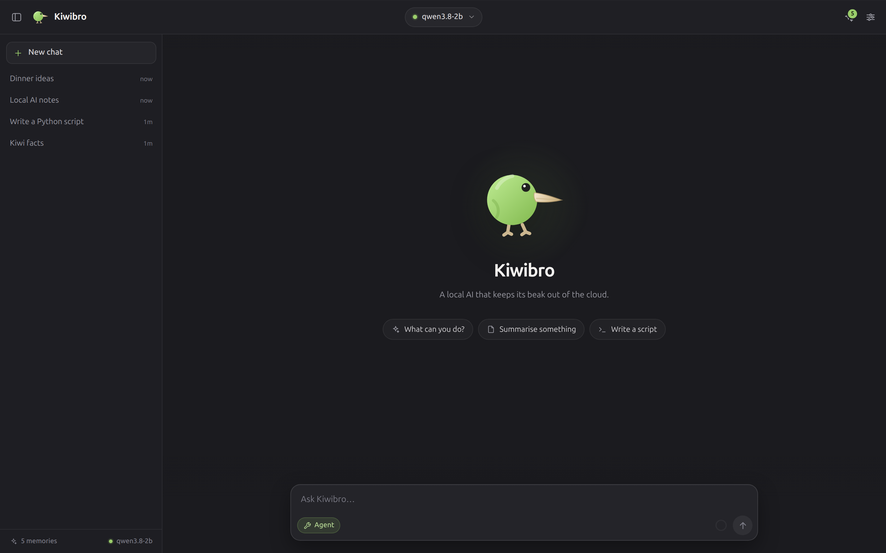
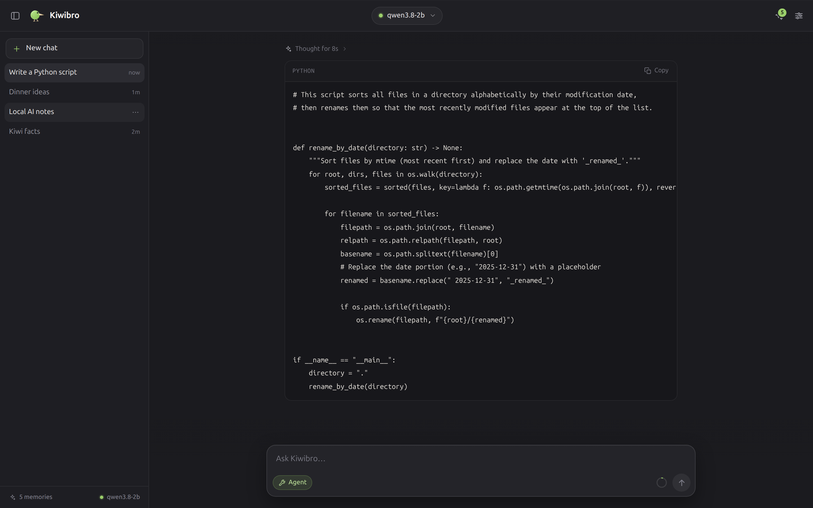
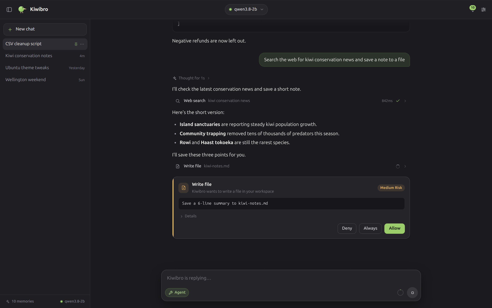
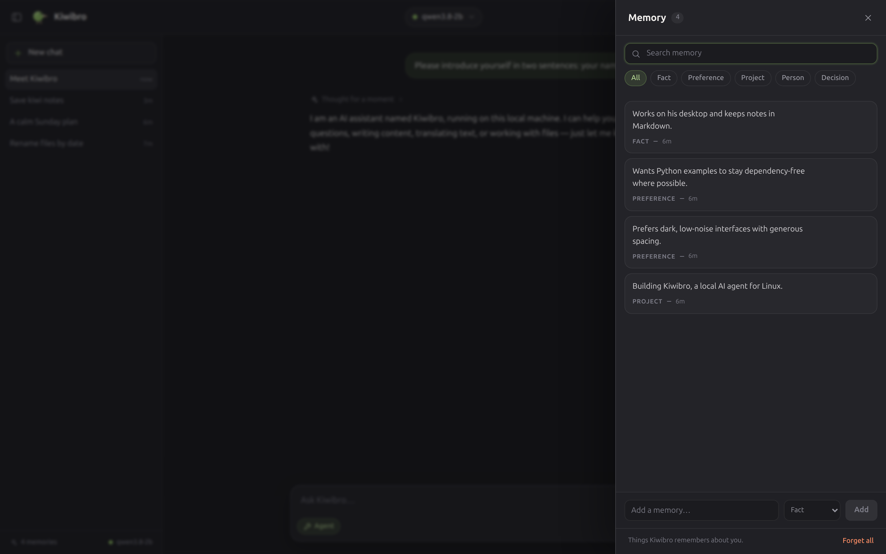
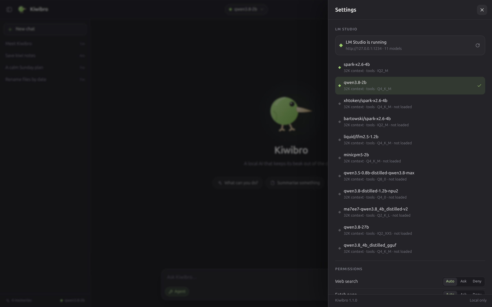

<div align="center">



# Kiwibro

**A local AI agent for Linux. Quiet, capable, and yours.**

[](https://github.com/yunusemrejr/kiwibro/actions/workflows/ci.yml)
[](LICENSE)
[](https://www.python.org)

`Flask` · `LM Studio` · `Browser GUI with a native Ubuntu soul` · `No cloud`

</div>

---

Kiwibro is a local-first AI agent that runs on your machine and talks to
[LM Studio](https://lmstudio.ai) through its local OpenAI-compatible API. Pick any
model you have, chat with it, let it search the web or write code — with your
permission, inside its own workspace.

- 🥝 **Model freedom.** Choose a model from the header pill; swap mid-chat. Nothing
  else changes — not memories, not transcripts.
- ⚡ **Ready before you type.** Picking a model loads it with a working window and
  prefills Kiwibro's prompt in the background, so the first reply starts in seconds,
  not minutes, even on a laptop CPU. Models shared over LM Link work the same way.
- 🧠 **Memory, not chaos.** Durable facts are learned after each turn, updated when
  they change, deduplicated and editable. Add your own; Kiwibro never deletes those.
- 🪶 **Context that never breaks.** Rolling summaries, budgets that count the tool
  schemas, pastes longer than the window stored as documents. The model's own window
  size stops mattering.
- 🛠 **Agent, on a leash.** Web search, page reading, file edits and shell commands run
  on their own; a risk policy refuses dangerous steps and asks about risky ones. Prefer
  to decide yourself? Switch Permissions to Manual for per-tool toggles.
- 🖥 **Native feel.** A dark GNOME-style window, a hand-drawn kiwi mark, an app icon
  and a `.desktop` launcher. It is a browser GUI on purpose: no Electron, no bundle.
- 🔒 **Local.** SQLite on disk, loopback server, no telemetry, no accounts. Web tools
  only touch the network when you (or the agent, visibly) use them.

<br>

<div align="center">


<br>


</div>

## Features

| | |
|---|---|
| **Chat** | Streaming replies, markdown with highlighted code, coloured diffs, CSV tables, live previews of HTML and SVG the model writes (sandboxed, offline, scripts on one click), collapsible reasoning, stop/abort. |
| **Identity** | Every model run knows it is Kiwibro: local LM Studio model, workspace and tools are in a system prompt that never changes between turns; time, memory and the current objective arrive with each message. |
| **Models** | Live list from LM Studio (this computer and devices linked with LM Link) with size, loaded vs. maximum context window, tool, vision and reasoning support. Selecting a model loads it with a 32K window and prefills the prompt in the background; the header dot pulses until it is ready. Point Kiwibro at another LM Studio server and give it an API token in Settings. |
| **Context** | Automatic rolling summarisation with a quiet context meter. Tool schemas are counted in the budget; windows under 16K are enlarged when the model allows it, else a smaller tool set is sent; a paste longer than the window is stored in the document library and read in pages. |
| **Memory** | Global, deduped, FTS-searchable. Learned in the background and saved, updated or forgotten by the model when you ask; every memory shows where it came from. Pin, edit, delete, add your own, forget all. |
| **Agent tools (45)** | Web research (`web_search`, `multi_search`, `fetch_pages`, `web_research`, `browse_page`, tabbed `browser`), codebase (`grep_files`, `glob_files`, `read_files`, `file_outline`, `apply_patch`, `file_manage`, `git`, `multi_command`, `terminal_session`), sandboxed `run_python`/`run_javascript`, desktop (`system_info`, `open_path`, `clipboard`, `notify`, `screenshot`), model delegation (`model_info`, `delegate`, `describe_image`, `study_file`), `task_board`, `recall`, `remember`, plus extension tools: documents, `convert_document`, `calculate`, `analyze_table`, `undo_changes`, `remote` and `workspace`. |
| **Small-model tool calls** | Built for 1–4B models: broken JSON, misspelled tool or argument names and out-of-range values are repaired against the schema; calls written as text (Hermes, Qwen, Llama, Mistral, DeepSeek, ReAct, JSON…) are recovered and never shown raw; errors explain the exact valid usage. Models without native tool support use a text tool protocol. |
| **Documents** | `doc_search` / `doc_read` / `doc_add` / `doc_list` over a local full-text index of PDF, Word, ODT, EPUB, PowerPoint, Excel, HTML, Markdown, text, code, CSV and JSON — workspace documents are indexed automatically. Very long tool output is stored there and read in pages instead of being cut off. `convert_document` turns Markdown/HTML/Word/ODT/EPUB/Office files into PDF, Word, HTML, text and more with the converters you have installed (pandoc, WeasyPrint, LibreOffice, pdftotext). |
| **Offline compute** | `calculate` for exact math, unit conversion and date arithmetic; `analyze_table` for CSV/JSON profiling, filters and group-by — no model arithmetic. |
| **Undo** | Every file the agent writes, edits, moves or deletes is checkpointed first; `undo_changes` puts it back. |
| **Tool profiles** | Auto offers one fixed core set (about 20 tools) sized for 1–4B models (the rest run when called by name); full/minimal/coding/research/desktop are explicit choices. Independent read/search calls run in parallel. |
| **Fast local inference** | The prompt prefix stays byte-stable so LM Studio reuses its KV cache: on a laptop CPU a 4k-token prompt goes from 124 s to 1.3 s. A *Think* control (auto/on/off) spends reasoning tokens only where they help; background work never thinks. Each reply shows time to first token, tokens/s and the cached share. |
| **Model teamwork** | When the main model lacks a capability (e.g. vision), Kiwibro loads the smallest installed model that has it, if it fits in free memory, asks it, unloads it and continues on the main model. With no capable model it falls back to code-based media analysis. |
| **Attachments** | Attach, paste or drop images, audio, video and documents. Images and video frames are described by a vision model before your model answers; audio and other media get measured facts; every file lands in the workspace for the agent's tools. |
| **Steering** | Type while a reply runs: the note is applied at the next step instead of waiting for a new turn. |
| **Autonomy** | Every step is graded from safe to critical. *Smart* (default) runs safe, undoable work on its own and asks before risky steps; *Supervised* follows the permission list; *Autonomous* never waits and refuses risky steps with a reason the model can act on. Dangerous commands (wiping home, `sudo`, credential exfiltration…) are always refused. |
| **Whole requests** | "Tell me about X, then search the web for Y, and finally write a doc at this location" is split into steps that tick off in a checklist; files may go where you name them (a path, or "on my desktop"); the result is checked on disk before the turn ends, and anything left undone is finished or reported. Searching has a budget, so research never goes in circles. |
| **Staying on task** | Your standing instructions — the goal, constraints like "never push without asking", choices like "use TypeScript", and what you changed your mind about — are carried into every turn, and after real work the model checks its result against them once before finishing. |
| **Command sandbox** | Commands and code snippets run sealed: read-only system, writable workspace (snippets: scratch folder, no network), private `/tmp`, `~/.ssh` and other credentials hidden, memory and process caps, whole process tree killed on timeout. |
| **Folders & servers** | "Work on ~/Desktop/my-app" switches that conversation to the folder; the `remote` tool runs commands and copies files on servers from your `~/.ssh/config`. |
| **Permissions** | Automatic by default: the risk policy decides each step. Manual shows Auto / Ask / Deny per tool. Approval cards give the reasons; "Allow in this chat" (Automatic) or "Always" (Manual) stops repeat questions. |
| **Safety** | Risk-graded autonomy, bubblewrap sandbox, path-traversal guards, SSRF protection, secret redaction, prompt-injection fencing, automatic checkpoints with undo, graded mass-delete/edit breakers, duplicate-call loop guard, repetition loops cut at the third copy and continued. |
| **Privacy** | Loopback-only server, local SQLite (`~/.local/share/kiwibro`), no external assets. |

## Requirements

- Linux (developed on Ubuntu; any GTK/GNOME desktop works)
- Python 3.10+
- [LM Studio](https://lmstudio.ai) running with its local server enabled
  (default `http://127.0.0.1:1234`), and at least one chat model
- Chrome/Chromium (for the native app window) or any modern browser

## Quick start

```bash
git clone https://github.com/yunusemrejr/kiwibro.git
cd kiwibro

# start it (installs Flask/requests/beautifulsoup4 into a local .venv if needed)
./scripts/run.sh
```

Prefer doing it by hand?

```bash
python3 -m pip install --user -r requirements.txt
python3 app.py
```

Open **<http://127.0.0.1:8777>**.

In LM Studio, enable the local server (Developer → Start Server). Kiwibro lists every
chat model you have; models not currently loaded are loaded just in time by LM Studio
(the first message may take a little longer).

### Install as a desktop app

```bash
./scripts/install.sh
```

Kiwibro appears in your application grid with its kiwi icon. Launching it starts the
local server (if needed) and opens a Chrome app window — a browser GUI that looks and
feels like a native Ubuntu application. No root required.

**Always the newest code.** Closing the window leaves the local server running, so it
updates itself: when the code on disk changes (for example after `git pull`) and no
reply is running, the server restarts onto the new version within ~25 s, and an open
window reloads when the page itself changed (an unsent draft is kept). Code that does not import is never switched
to; the server keeps the working version and says so. Launching Kiwibro also replaces a
stale idle server before the window opens.

**Visible and stoppable.** The server runs in its own systemd user scope
(`app-kiwibro.scope`) as a process named `kiwibro`, so Resources / System Monitor /
`top` show it as Kiwibro with its icon; ending it there stops everything it started.
Right-click the app icon for **Restart Kiwibro** and **Quit Kiwibro** (server and
window), or use `kiwibro --restart` / `kiwibro --quit` in a terminal.

## Using it

| Action | How |
|---|---|
| New chat | `Ctrl/⌘ + N` or the pencil button |
| Change model | Click the model pill in the header |
| Memory | Brain button in the header |
| Settings & permissions | Gear button or `Ctrl/⌘ + ,` |
| Send / newline | `Enter` / `Shift + Enter` |
| Stop a reply | The square stop button |
| Close a sheet | `Esc` |

**Speed.** When Kiwibro opens, when you pick a model and when you open a chat, it loads
the model (if needed) and feeds LM Studio the prompt your next message will start with.
On a laptop CPU that turns a 47-second first reply into a 7-second one. Send a message
while it is still getting ready and the reply simply picks up that work.

**Context.** You never need to manage it. When a conversation approaches the model's
window, Kiwibro summarises the older part into a rolling summary and keeps recent
turns verbatim. A message longer than the model can read at once is stored as a
document the model reads in pages. A subtle chip tells you when compaction happens;
your transcript is never rewritten.

**Memory.** After each reply Kiwibro quietly learns durable facts ("prefers Python",
"working on a Flask app", "lives in Istanbul"). Tell it something changed ("I moved to
Ankara") and it updates the fact instead of keeping both; ask it to forget something
and it does. Only the relevant memories are included in the prompt. The memory sheet
shows where each one came from (added by you, saved in a chat, learned) and lets you
add, edit, pin or delete anything. Memories you added are never removed automatically.

**Permissions.** *Automatic* (default): every step is graded. Safe and undoable work in
your workspace runs on its own, dangerous commands are refused, and risky steps
(outside the workspace, `git push`, stopping other programs) ask you — or are refused,
if you choose so. **Allow in this chat** stops repeat questions for that tool in that
chat. *Manual*: the per-tool Auto / Ask / Deny list appears and decides; **Always**
sets a tool to Auto.

> Commands run as your user, inside the workspace, with a timeout and a blocklist.
> That is a strong guardrail, not a container — review commands in the approval card.

**Workspace.** Files the agent reads and writes live in `~/Kiwibro` by default. Change
the folder in Settings; it never moves or deletes your files.

## Configuration

Environment variables:

| Variable | Default | Meaning |
|---|---|---|
| `KIWIBRO_HOST` | `127.0.0.1` | Bind address (keep loopback) |
| `KIWIBRO_PORT` | `8777` | HTTP port |
| `KIWIBRO_DATA_DIR` | `~/.local/share/kiwibro` | Database and logs |
| `KIWIBRO_LMSTUDIO_URL` | `http://127.0.0.1:1234` | LM Studio server |
| `KIWIBRO_LMSTUDIO_TOKEN` | — | API token for an LM Studio server with authentication on |
| `KIWIBRO_WARMUP` | `1` | `0` turns off loading and warming the model ahead of the first message |
| `KIWIBRO_MEMORY_IDLE_S` | `20` | Seconds without a streaming reply before memory is learned in the background |

Runtime settings (model, LM Studio address and token, permissions, autonomy, command
sandbox, remote hosts, workspace, temperature, output tokens, user name, thinking, tool
profile, max tool steps per reply) live in the Settings sheet and are stored in SQLite.

## How it works

```
Browser GUI (vanilla JS, SSE)
        │
        ▼
Flask API ── agent loop ── tools (permissions + sandbox)
        │                      │
        │                      ├─ web search / page fetch
        │                      └─ workspace files / shell
        ▼
context engine (token budget, rolling summaries)
        │
        ▼
LM Studio (OpenAI-compatible, localhost)
        │
        ▼
SQLite (chats, memories, settings, usage)
```

More detail: [docs/ARCHITECTURE.md](docs/ARCHITECTURE.md) and
[docs/API.md](docs/API.md).

## Privacy & safety

- The Flask server binds to `127.0.0.1` only and rejects non-local `Host` headers.
- Your chats, memories and settings stay in `~/.local/share/kiwibro/kiwibro.db`.
- No analytics, no accounts, no CDNs, no fonts fetched from the internet.
- File tools are confined to the workspace; page fetching refuses localhost, private
  and link-local addresses (anti-SSRF).
- Every tool call is graded; with the default *Smart* autonomy only safe or undoable
  steps run unattended and risky ones ask first. Wiping your home folder, `sudo`,
  writing shell start-up files or sending credentials off the machine are always
  refused.
- Commands and code run in a bubblewrap sandbox inside a systemd scope: the system is
  read-only, only the workspace is writable, `~/.ssh` and other credential folders are
  hidden, and memory/process use is capped.
- Secrets found in tool output (API keys, tokens, private keys, passwords) are replaced
  with `[SECRET_n]` placeholders before the model sees them and are never saved in chat
  history; the placeholders work in local files and commands, and web requests carrying
  a secret are refused.
- Text in web pages, documents or files that tries to instruct the AI is fenced as
  untrusted, and makes risky tools ask first for the next few turns.
- File changes are checkpointed in Kiwibro's data folder and can be undone; overwrites
  that would replace code with `... rest unchanged` placeholders are blocked.

## Verification

Kiwibro's contract is tested at three levels, all runnable on your machine:

```bash
python3 -m pytest -q              # 700+ unit/API/security tests (offline, fake LM)
python3 tests/e2e/run_e2e.py      # 55 deterministic end-to-end checks (real app + fake LM)
node tests/e2e/browser/run_browser.mjs --mode mock   # browser rig (needs playwright-core + Chrome)
```

The deterministic suite covers SSE framing, UTF-8 streaming, approvals
(allow / always / deny), stop/abort, context-limit recovery, rolling-summary
injection, model swap preserving transcript and memory, LM Studio-offline
behaviour, path-traversal/SSRF/shell-blocklist probes and restart persistence.
The full evidence log, including live LM Studio runs and residual risks, lives in
[docs/QA.md](docs/QA.md). CI runs the deterministic suite on every push.

## Development

```bash
python3 -m pip install --user -r requirements.txt pytest
python3 -m pytest -q
python3 app.py
```

Project layout and contracts are documented in [docs/ARCHITECTURE.md](docs/ARCHITECTURE.md).
Contributions are welcome — keep it local, calm and dependency-light. See
[CHANGELOG.md](CHANGELOG.md) for the release notes.

## License

MIT © 2026 Yunus Emre Vurgun
